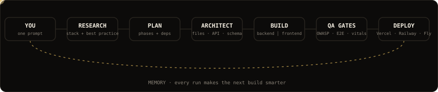

<div align="center">
  
  
</div>

<div align="center">
  
</div>

<div align="center">
  <a href="https://rajbharti.in"></a>
  <a href="https://www.firelly.in"></a>
  <a href="https://www.linkedin.com/in/rajbharti-in"></a>
  <a href="https://orcid.org/0009-0000-8162-7611"></a>
  <a href="https://x.com/RajBharti06"></a>
  <br/>
  
</div>

<br/>

<div align="center">
  <b>Cybersecurity undergrad at RIT Croatia, Zagreb. Founder of <a href="https://www.firelly.in">Firelly</a>.</b><br/>
  I build security and AI systems that run without sending your data anywhere,<br/>
  and publish open research on how identity attacks actually succeed.
</div>

<br/>

<div align="center">
  
</div>


## ⛓️ Philosophy

```python
class RajBharti:
    role     = ["AI & Cybersecurity Engineer", "Independent Researcher", "Founder @ Firelly"]
    location = "Zagreb, Croatia"
    focus    = "identity security · offline inference · multi-agent systems"

    def principles(self) -> list:
        return [
            "run offline, zero data leaves the device",
            "privacy by design, not as an afterthought",
            "publish open research anyone can read",
            "ship it, then prove it works",
        ]

    def current(self) -> str:
        return "Firelly · ARGUS · Orchestrator X"
```


## 🏆 Recent Wins

<div align="center">

| | |
|:---|:---|
| 🥇 **#948 of 4,094** | HackerRank Orchestrate, October 2026 · "The Survivor" |
| 🥈 **276th place** | HackerRank Orchestrate, May 2026 · with [SafeRoute](https://github.com/Rajbharti06/SafeRoute) |
| 🧩 **2 agent skills published** | [Root-Cause Debugger](https://www.agensi.io/skills/root-cause-debugger-proven-bug-fixes) and [Layered Security Scan](https://www.agensi.io/skills/layered-security-scan-owasp-top-10) on Agensi |
| 📄 **2 open-access case studies** | Harvard and Princeton breaches, on Zenodo |

</div>


## 🔬 Research

<div align="center">

| Paper | Venue | Status |
|:---|:---|:---:|
| **The Identity Exploitation Model** · quantifying compound breach risk in AiTM phishing campaigns | Preprint | 📝 Preprint |
| [The Harvard University Data Breach: Identity-Centric Threats and the Failure of MFA](https://zenodo.org/records/19344102) | Zenodo | 📄 Open access |
| [Princeton University Data Breach and Its Cybersecurity Implications in Higher Education](https://zenodo.org/records/19136388) | Zenodo | 📄 Open access |

</div>

> **The Identity Exploitation Model (IEM)** is a four-layer sequential framework that treats a breach as a chain rather than a set of independent failures. It computes end-to-end probability across Human Trust, Authentication, Interception and Privilege. Monte Carlo simulation over five documented university breaches puts FIDO2 migration at a 72% reduction in breach probability, against 15% for awareness training alone. Grounded in MITRE ATT&CK and STRIDE. ORCID [0009-0000-8162-7611](https://orcid.org/0009-0000-8162-7611).


## 🌐 Live on the Web

<div align="center">

| | Project | What it is |
|:---:|:---|:---|
| 🔥 | [**Firelly**](https://www.firelly.in) | Free AI prep for IELTS, SAT, TOEFL, DET and AP that calms test nerves instead of adding to them. |
| 🎮 | [**Stormwing**](https://stormwing.rajbharti.in) | Roguelite dogfighting in the browser. Co-op for 2–4 pilots, free-for-all rooms, world rankings. |
| 🏎️ | [**RB Motorsport · F1 3D Web**](https://rbmotors.rajbharti.in) | Scroll-driven 3D study of a fictional F1 car across seven chapters. Clips made with Google Flow. |
| 🎓 | [**ScholarQuest**](https://scholarquest.firelly.in) | Affordable degrees, full-aid universities and scholarships. Every figure is sourced and dated. |

</div>


## ⚙️ What I Build

<table>
<tr>
<td width="50%" valign="top">

### 🛡️ ARGUS &nbsp;[→](https://github.com/Rajbharti06/ARGUS)
**Autonomous Cyber Defense Platform**

Seven-module SOC dashboard. VEIL for phishing triage on Qwen3.6-35B-A3B, ORACLE for attack correlation on NVIDIA Nemotron 49B, IDENTITY for behavioral trust scoring.

Live CVE and CISA KEV feeds, real host telemetry. No mock data anywhere in production endpoints.

`Python` `FastAPI` `React 18` `WebSockets`

</td>
<td width="50%" valign="top">

### 🧠 Orchestrator X &nbsp;[→](https://github.com/Rajbharti06/The-Orchestrator)
**Multi-Agent Software Factory**

One plain-English prompt in; a planned, built, tested and deployed app out. 45 agents, 26 skills, 11 quality gates and 6 LLM providers, with a memory that makes every build smarter than the last.

Ships to Vercel, Railway, Render or Fly.io.

`JavaScript` `Node.js` `Multi-Agent LLMs`

</td>
</tr>
<tr>
<td width="50%" valign="top">

### 🔥 Firelly &nbsp;[→](https://www.firelly.in)
**AI Test Prep That Calms Your Nerves**

Free prep for IELTS, SAT, TOEFL, DET and AP. Mira, an AI mentor, coaches you from your own practice data. Calm Mode opens practice with a breathing exercise.

Most prep platforms optimize for pressure. This one doesn't.

`Next.js 15` `TypeScript` `Vercel`

</td>
<td width="50%" valign="top">

### 🤖 My Mitra &nbsp;[→](https://github.com/Rajbharti06/My-Mitra)
**Privacy-First Offline AI Companion**

100% on-device LLM inference at roughly 120ms latency on mid-range Android. Habits, journaling, routines, all stored locally.

Zero exfiltration by architecture, not by policy. Nothing is ever transmitted.

`Python` `FastAPI` `Ollama` `Mistral`

</td>
</tr>
<tr>
<td width="50%" valign="top">

### 🔒 ClaimGuard Vision &nbsp;[→](https://github.com/Rajbharti06/ClaimGuard-Vision)
**Evidence-Based Claims Verification**

Verifies insurance and delivery damage claims from images and conversation history. Deterministic guardrails override model hallucinations with hard business rules.

Hardened against prompt injection hidden in images, with watermark detection to catch stock-photo fraud.

`Python` `Vision LLMs` `Multi-Provider Failover`

</td>
<td width="50%" valign="top">

### 🩺 PulseLock AI &nbsp;[→](https://github.com/Rajbharti06/PulseLock-AI)
**Always-On Access Firewall**

Intercepts every request touching patient data, whether it comes from a human, a service or an AI agent, and makes a real-time allow or deny decision before execution.

`JavaScript` `Zero Trust`

</td>
</tr>
<tr>
<td width="50%" valign="top">

### 📊 HireFlow AI &nbsp;[→](https://github.com/Rajbharti06/hireflow-ai)
**AI Resume Screener** · `AGPL-3.0`

Three-signal hybrid scoring: sentence embeddings, skill-graph overlap, LLM reasoning. Ranks 100+ resumes in seconds with plain-English explanations.

Zero-Cost Mode runs fully offline on a local model. No API key needed.

`Python` `Streamlit` `Supabase`

</td>
<td width="50%" valign="top">

### 🎤 IntervAI &nbsp;[→](https://github.com/Rajbharti06/IntervAI)
**AI Interview Simulator**

Real-time Whisper ASR under 2s latency. Detects hesitation, interrupts rambling, adapts tone to the interviewer personality you pick.

Most people don't enjoy using it. That's the point.

`Python` `Whisper` `Streamlit`

</td>
</tr>
</table>


## 🛰️ Orchestrator X, Live

<div align="center">
  
</div>


## 🧩 Agent Skills

| Skill | What it does | |
|:---|:---|:---:|
| [**Root-Cause Debugger**](https://www.agensi.io/skills/root-cause-debugger-proven-bug-fixes) | Won't let an AI agent call a bug fixed until it's reproduced by a failing test, traced to its root cause, verified and checked for shortcuts. | `$12` |
| [**Layered Security Scan**](https://www.agensi.io/skills/layered-security-scan-owasp-top-10) | OWASP Top 10 scan in three layers: 29 pattern rules, an optional Semgrep pass, then an agent review that drops false positives. | `Free` |
| [**Showrunner Agent Skills**](https://github.com/Rajbharti06/showrunner-agent-skills) | 24 skills that plan, write and check content for YouTube, Instagram, TikTok, LinkedIn and more. No dependencies. | `Open source` |

<details>
<summary><b>More projects</b></summary>

<br/>

| Project | What it does |
|:---|:---|
| [**Revenant**](https://github.com/Rajbharti06/Revenant) | AI-assisted audit agent that proves whether "deleted" personal data is truly gone. |
| [**SafeRoute**](https://github.com/Rajbharti06/SafeRoute) | Trust-aware AI support triage. Corpus-grounded routing with risk-aware escalation, self-verification and prompt-injection defense. 276th globally in HackerRank Orchestrate. |
| [**SANJAYA Edge**](https://github.com/Rajbharti06/SANJAYA-EDGE) | AI road-safety copilot. Computer vision plus traffic-law context for real-time violation detection and multilingual alerts. |
| [**LoanDoc Guardian**](https://github.com/Rajbharti06/LoanDoc-Guardian) | AI risk intelligence for syndicated loan documentation review. |
| [**Jarvis Coder**](https://github.com/Rajbharti06/Jarvis-Coder) | Offline AI coding assistant. Monaco Editor and FastAPI with local inference, no GPU, no cloud. |
| [**DRIFT**](https://github.com/Rajbharti06/DRIFT) | Daily cooperative word game on Reddit. Ten players relay a secret word through 3-word clues. The full chain reveals at midnight. |

</details>


## 🧰 Stack

<p align="center">
  
</p>

```
AI / ML     Ollama · Mistral · Qwen3 · Whisper ASR · HuggingFace · LangChain · RAG · FAISS
Agents      Multi-agent pipelines · Agent Skills · LLM routing · Eval loops
Security    MITRE ATT&CK · STRIDE · Threat Modeling · Zero Trust · OSINT · Prompt-Injection Defense
Web         Next.js · React Three Fiber · WebGL · GSAP · Lenis
Infra       Docker · Cloudflare R2 · Vercel · Railway · Render · WebSockets
```


## 📈 Activity

<div align="center">

  
  

  <br/><br/>

  

  <br/><br/>

  

  <br/><br/>

  <picture>
    <source media="(prefers-color-scheme: dark)" srcset="https://raw.githubusercontent.com/Rajbharti06/Rajbharti06/output/github-snake-dark.svg" />
    
  </picture>

</div>

<div align="center">
  <h3>Build systems. Publish research. Ship things that matter.</h3>
  <a href="https://rajbharti.in"><b>rajbharti.in</b></a>
  <br/><br/>
  <i>Portfolio · Publications · Full project list</i>
</div>


